<div align="center">

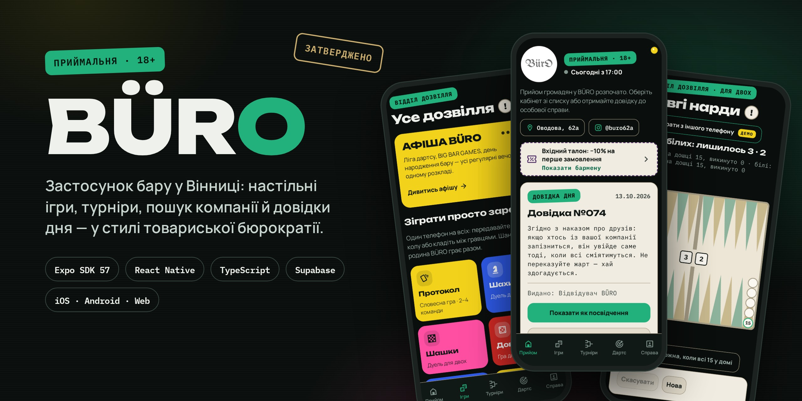

# BÜRO

**Мобільний застосунок бару «Бюро» у Вінниці — настільні ігри, турніри, пошук компанії й довідки дня у стилі товариської бюрократії.**

[](https://anton-yarmilko.github.io/buro-app/)
[](media/demo.mp4)


</div>

---

## Демо

<table>
<tr>
<td width="44%" align="center">
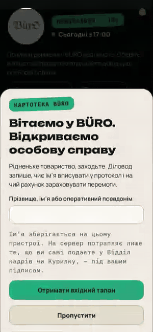
<br><sub><a href="media/demo.mp4">Повне відео в MP4</a></sub>
</td>
<td>

### Спробувати за хвилину

**[anton-yarmilko.github.io/buro-app](https://anton-yarmilko.github.io/buro-app/)**

Найкраще — з телефона або у вузькому вікні браузера.

1. Впишіть ім’я або «оперативний псевдонім» — отримаєте вхідний талон −10%.
2. На «Приймальні» — довідка дня, своя для кожного гостя й дня.
3. «Ігри» → нарди, шахи, шашки, «Бюрократ», «Врятуй товариша».
4. «Дартс» → 501 на двох, підказки закриття до 170.
5. «Турніри» → сітка на 4–32 учасники за хвилину.

> Демо працює в **демо-режимі**: без справжньої бази й облікових записів. Усе зберігається лише у вашому браузері.

</td>
</tr>
</table>

## Скріни

<table>
<tr>
<td align="center">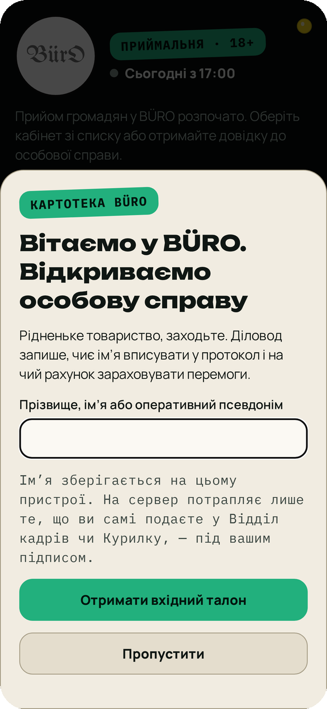<br><sub><b>Перший запуск</b><br>особова справа</sub></td>
<td align="center">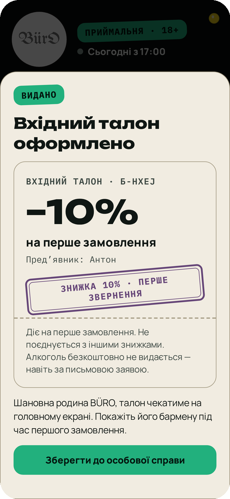<br><sub><b>Вхідний талон</b><br>−10% на перше замовлення</sub></td>
<td align="center">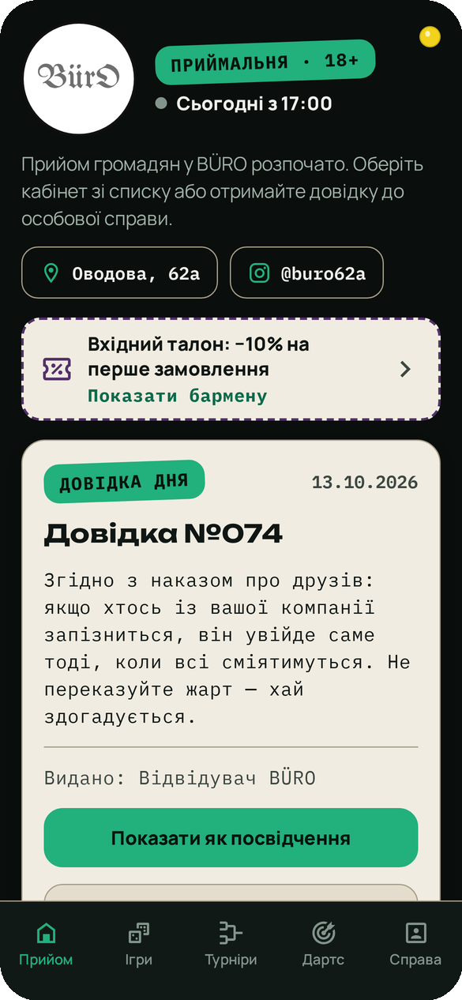<br><sub><b>Приймальня</b><br>довідка дня</sub></td>
<td align="center">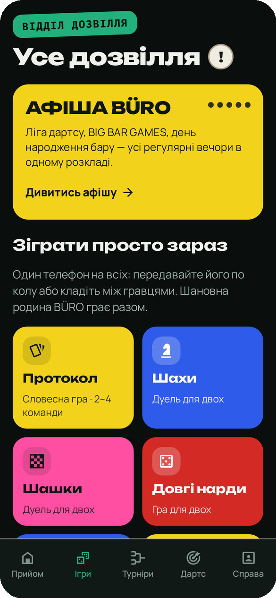<br><sub><b>Дозвілля</b><br>ігри й правила</sub></td>
</tr>
<tr>
<td align="center">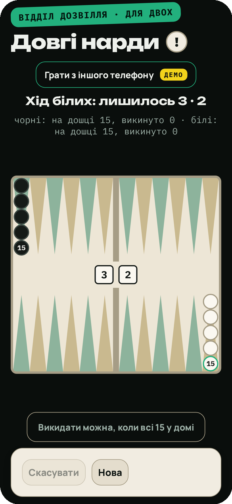<br><sub><b>Довгі нарди</b><br>на одному телефоні</sub></td>
<td align="center">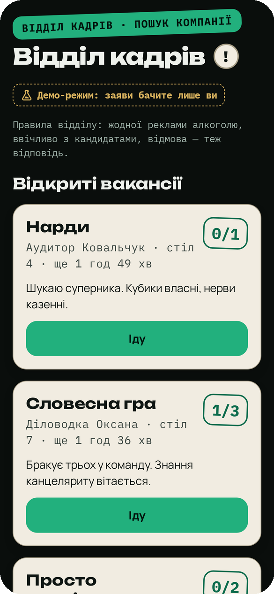<br><sub><b>Відділ кадрів</b><br>пошук компанії</sub></td>
<td align="center">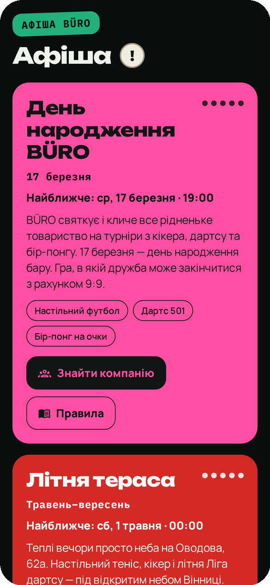<br><sub><b>Афіша</b><br>події бару</sub></td>
<td align="center">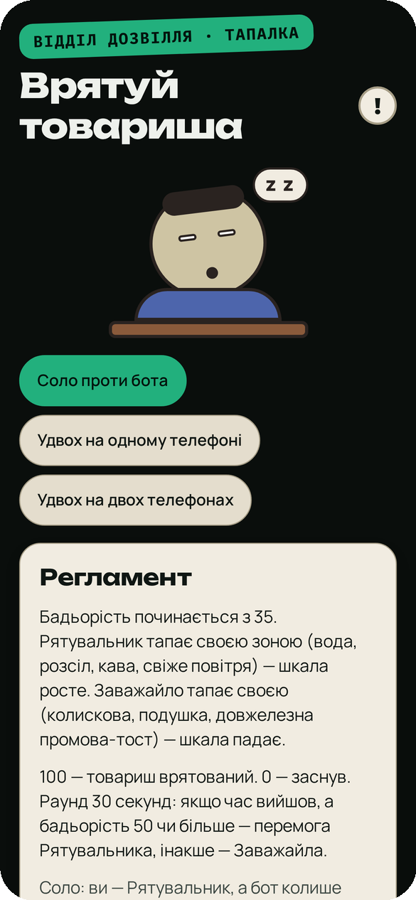<br><sub><b>Врятуй товариша</b><br>міні-гра</sub></td>
</tr>
</table>

<details>
<summary><b>Ще екрани</b> — шахи, дартс, турнірна комісія, профіль</summary>
<br>
<table>
<tr>
<td align="center">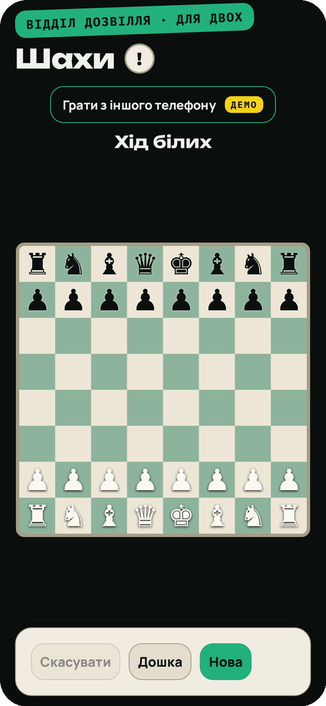<br><sub>Шахи</sub></td>
<td align="center">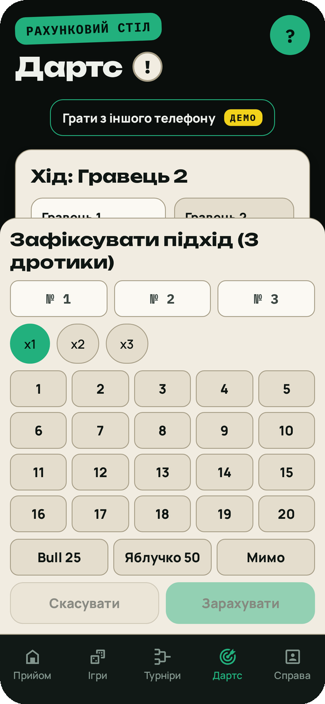<br><sub>Дартс 501</sub></td>
<td align="center">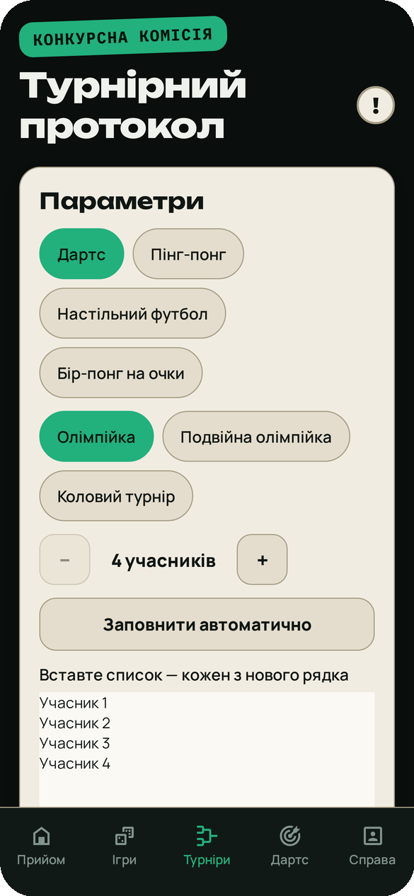<br><sub>Турнірна комісія</sub></td>
<td align="center">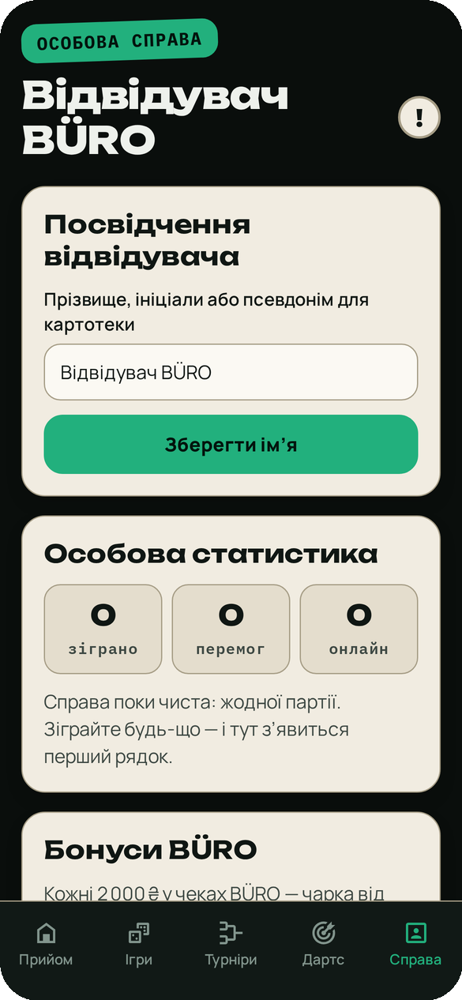<br><sub>Особова справа</sub></td>
</tr>
</table>
</details>

## Що всередині

**Концепція.** Бар як пародійна установа: «Приймальня», «Відділ кадрів», «Конкурсна комісія», «Особова справа». Довідки з печатками, талончики, товариський сарказм замість реклами.

| Розділ | Що робить |
|---|---|
| Приймальня | Довідка дня, талон, швидкі переходи |
| Дозвілля | Шахи, шашки, нарди, словесна й карткова гра |
| Правила | 3 рівні: 30 секунд · повні · нюанси |
| Дартс | 301 / 501 / Cricket, 2–8 гравців, checkout ≤ 170 |
| Турніри | Олімпійка, подвійна, колова; 4–32 учасники |
| Відділ кадрів | Заяви «шукаю компанію», зникають за 2 год |
| Курилка | Нічний чат, повідомлення живуть 24 год |
| Особова справа | Статистика, код гостя, колекція знаків |
| Каса / Бухгалтерія | Збір на банку, рахунок (інтеграція з Poster) |

**Принципи, закладені в продукт**

- **18+ і відповідально.** Жодного обліку випитого, рейтингів за чеком чи нагород алкоголем — це правило закладено в ТЗ.
- **Офлайн-перше.** Профіль і прогрес живуть на пристрої; серверна справа — лише за бажанням, і її можна стерти в профілі.
- **Доступність.** Мінімальний текст 15 px, підписи для читачів екрана, контраст ≥ 4.5:1, світла й темна теми.

## Технічно

| | |
|---|---|
| Клієнт | Expo SDK 57 · React Native 0.86 · expo-router · Reanimated 4 |
| Мова | TypeScript, ~15.6 тис. рядків |
| Бекенд | Supabase: Postgres, RLS, RPC, Edge Functions |
| Інтеграції | Poster POS, monobank-банка |
| Тести | 331 тест у 51 файлі: Jest, node:test, Playwright |
| Платформи | iOS · Android · Web (статичний експорт) |

```text
app/            екрани (expo-router, файлова маршрутизація)
src/domain/     чиста логіка: дартс, турніри, нарди, шахи, довідки — з юніт-тестами
src/features/   UI-модулі розділів
src/backend/    Supabase-клієнт, RLS-безпечні RPC, демо-сервіси
content/        JSON-контент: правила, довідки дня, квізи, афіша
supabase/       міграції SQL і Edge Functions
e2e/            Playwright-сценарії на мобільному в’юпорті 390×844
```

**Як влаштовано демо.** Прапорець `EXPO_PUBLIC_FORCE_DEMO=1` підміняє всі мережеві сервіси локальними демо-реалізаціями. На цій же збірці бігають E2E-тести — тож демо, яке ви відкриваєте, перевірене тим самим набором сценаріїв.

## Статус

- [x] Ігри, турніри, дартс, правила, довідки дня
- [x] Соціальні розділи на Supabase з RLS
- [x] Видалення акаунта, політика конфіденційності
- [ ] Публікація в App Store та Google Play — _у процесі_
- [ ] Живе меню й рахунок через Poster

<div align="center">

---

<sub>Задумано, спроєктовано й зібрано <b>Антоном Ярмілком</b> · Вінниця, 2026<br>
Код застосунку — у приватному репозиторії. Тут — вітрина, демо й медіа.</sub>

<sub><a href="#en">English summary ↓</a></sub>

</div>

<a id="en"></a>

<details>
<summary><b>English summary</b></summary>
<br>

**BÜRO** is a mobile app for a bar in Vinnytsia, Ukraine, built with Expo / React Native, TypeScript and Supabase. The whole UI plays on friendly bureaucracy: a daily "certificate", a welcome coupon, a "HR department" for finding people to play with, and a "competition committee" for tournaments.

- **Games:** chess, checkers, long backgammon, a card game, a word game and a rescue mini-game, playable on one phone.
- **Darts scorer:** 301/501/Cricket, 2–8 players, checkout hints up to 170.
- **Tournaments:** single/double elimination and round robin, 4–32 players.
- **Social:** "looking for players" posts and a night chat, backed by Supabase with row-level security.
- **Quality:** 331 tests (Jest, node:test, Playwright E2E), accessible type and contrast, light and dark themes.
- **Responsible by design:** no drink counters, spend rankings or alcohol rewards.

**[Try the live demo →](https://anton-yarmilko.github.io/buro-app/)** (demo mode, no backend; data stays in your browser).

</details>
